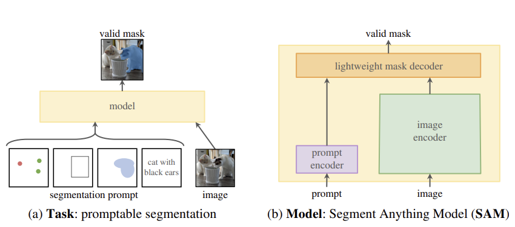
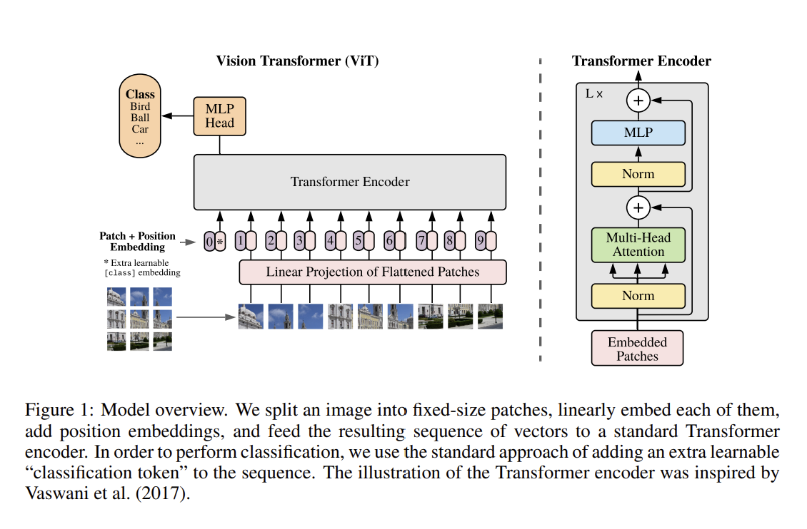
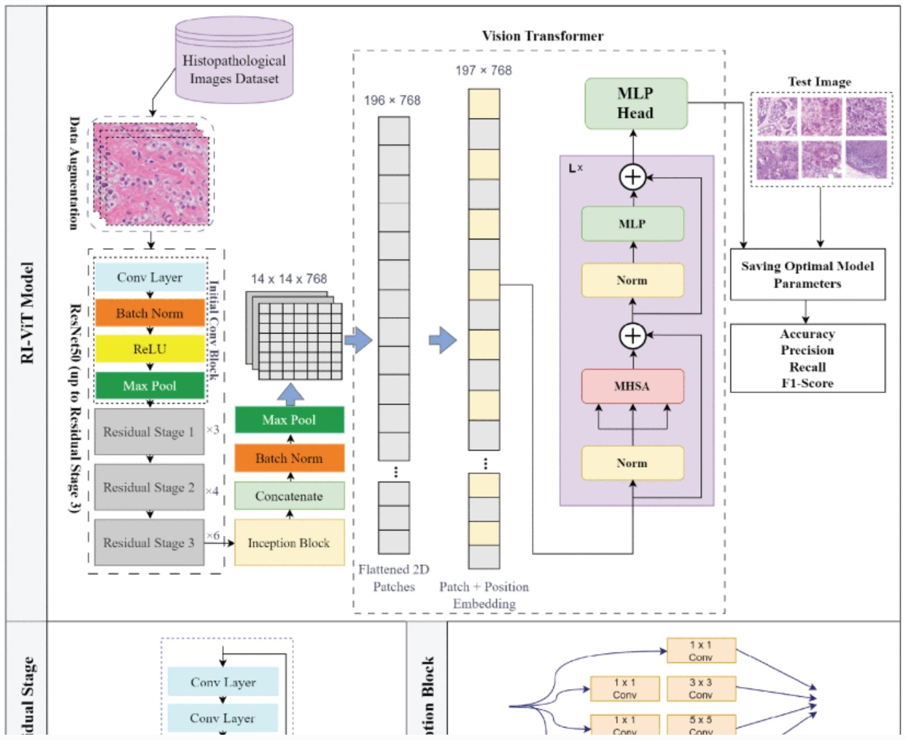
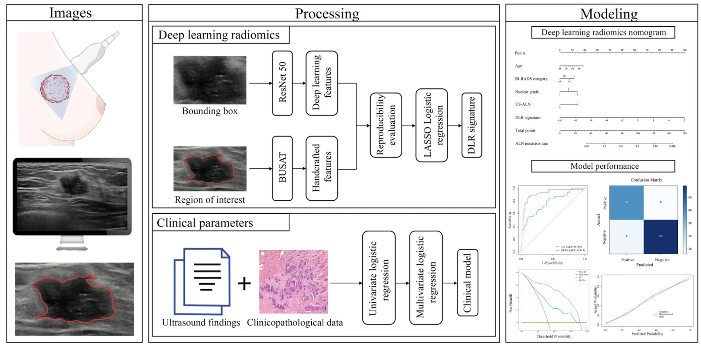

# Introducere

Detectarea cancerului de sân în mamografii este o problemă critică în
imagistica medicală și diagnostic. Interpretarea mamografiilor este
provocatoare din cauza variațiilor în densitatea țesuturilor, a
structurilor suprapuse și a diferențelor subtile dintre tumorile benigne
și maligne. Această problemă trebuie rezolvată folosind un algoritm
inteligent, deoarece examinarea manuală tradițională de către radiologi
este consumatoare de timp și predispusă la erori umane.

Cancerul de sân este cea mai frecventă formă de cancer la femei și a
doua cauză a deceselor provocate de tumorile maligne, după cancerul de
plămân, în populația feminină. Boala se declanșează atunci când unele
celule din structura glandei mamare capătă anumite mutații la nivel
genetic și se înmulțesc incontrolabil, formând o tumoră.

Se estimeaza că 1 din 8 femei va fi diagnosticata de-a lungul vieții cu
această boală. Însa cancerul de sân nu este apanajul doar al femeilor,
el fiind întâlnit, rar, și la barbați. La nivel global, 1,7 milioane de
cazuri de cancer mamar sunt diagnosticate anual și mai mult de 500 000
paciente decedează din această cauza; numarul cazurilor la barbați
reprezintă 1 procent din total.

Europa continuă să constituie unul dintre continentele cu cea mai
crescută incidență a cancerului de sân. Deși constituie o suferință
extrem de traumatizantă pentru femei, cancerul mamar poate fi prevenit
și, dacă este descoperit în stadii incipiente, se tratează și se
vindecă.

## Scopul aplicației

Aplicația propusă are ca scop asistarea medicilor în evaluarea riscului
de apariție a metastazei ganglionare limfatice axilare (MGLA) în
cancerul mamar. Acest lucru este util mai ales în contextul în care
descoperirea timpurie a afecțiunii poate oferi diversitate în opțiunile
de tratament și șanse ridicate de vindecare.

## Descrierea aplicației

Deoarece utilizatorul aplicației cel mai probabil nu va avea un profil
tehnic, ci va face parte din industria medicală, am decis să păstrăm un
design intuitiv al aplicației și pași simpli în navigarea acesteia.
Astfel, când se deschide aplicația, vor fi afișate două butoane: unul
care facilitează încărcarea mamografiei dorite, iar cel de-al doilea
care va iniția analiza. După ce sunt încărcate datele și este pornită
simularea, în colțul din stânga jos va apărea probabilitatea găsită de
algoritm cu privire la riscul detectării unei posibile MGLA.

# Analiza literaturii de specialitate

## Predicția metastazelor ganglionare axilare bazată pe parametri clinici si ecografici

În această lucrare [@alnm_decision_tree], autorii propun un model de
predicție a metastazelor ganglionare axilare (ALNM) folosind un set de
date provenit de la 1671 de paciente cu cancer mamar operabil (împărțit
în 900 de date pentru antrenare si 761 pentru testare). Datele îmbină
trăsături clinico-patologice (vârstă, IMC, palpabilitate) cu parametri
de ecografie de înaltă frecvență (dimensiunea tumorii, infiltrarea
țesutului adipos etc.). Ca algoritmi de AI, s-a utilizat algoritmul de
clasificare bazat pe arbori de decizie C5.0, alături de analize de
regresie logistică. Modelele au înregistrat o acuratete de 69.52% si o
rată de fals-negative (FNR) de 74.18%.

## Straturi de Cross-Attention pentru fuziunea trăsăturilor (Feature Fusion)

Această lucrare [@cross_attention_fusion] detaliază un mecanism neuronal
de tip *Cross-Attention*, care este o componentă arhitecturală esențială
pentru abordarea noastră de a îmbina cele două tipuri de date eterogene
(imagini și text). Fiind un studiu axat pe arhitectură, formalizează
matematic algoritmul AI prin care se face transferul selectiv de
informatii între domeniile de date folosind proiecții de tip Query, Key
si Value ($Q=XW_Q, K=YW_K, V=YW_V$).

## \"Segment Anything\" (SAM) [@sam]

Lucrarea introduce modelul SAM pentru segmentarea imaginilor bazat pe
prompturi (punct, bounding box, mască, text). Arhitectura îmbină 3
componente principale:

1.  image encoder - vision transformer adaptat pentru procesarea datelor
    de intrare la rezoluție mare

2.  prompt encoder - promptul este reprezentat prin positional encoding.
    În cazul în care prompt-ul este dat sub formă de mască, embedding-ul
    se obține prin aplicarea de covoluții.

3.  mask decoder - transformer decoder urmat de mask prediction head,
    care generează maștile de segmentare combinând embedding-urile
    imaginilor și prompturilor

Modelul a fost antrenat pe SA-1B, un set de date conținând 11 milioane
de imagini și 1 miliard de maști de segmentare. Datele au fost colectate
pe parcursul dezvoltării modelului, în 3 etape: manual asistat, semi
automat, complet automat. SAM a obținut un Dice Score de 96% in
segmentarea pulmonară.

<figure data-latex-placement="h">

<figcaption>Imagine preluată din .</figcaption>
</figure>

## \"An Image is Worth 16x16 Words\" (ViT) [@imageworth16x16words]

Această lucrare demonstreaza că arhitectura transformer, folosită
inițial în procesarea limbajului natural, poate fi utilizată cu succes
în computer vision. Vision Transformer tratează o imagine ca pe o
secvență de 'patch-uri', similar modului de procesare a cuvintelor
dintr-o propoziție. Fiecare patch este transformat într-un vector (patch
embedding) și procesat de un transformer encoder, folosind mecanismul de
self attention. Pentru păstrarea informațiilor spațiale, la patch
embeddings se adaugă positional embeddings.

Ca alternativă la utilizarea de imagini ca input, se propune o
arhitectură hibridă, unde input-ul este format dintr-o serie de
feature-uri extrase de un CNN.

ViT antrenat pe un volum mare de date depășește performanța abordării
bazate pe convoluții, însă pe un set de date limitat performanța scade
semnificativ, sub cea obținută de ResNet.

<figure data-latex-placement="h">

<figcaption>Imagine preluată din .</figcaption>
</figure>

## Model Hibrid CNN-ViT

Ambele tehnologii sunt utilizate în procesarea imaginilor (atât rețelele
neuronale convoluționale - CNN, cât și Vision Transformer), însă au
abordări, calități și defecte diferite. Anterior s-a discutat mai în
detaliu soluția ViT, care se bazează exclusiv pe mecanismul de atenție,
dar care da dovadă de anumite neajunsuri în cazul studierii
mamografiilor: poate rata texturile fine precum microcalcificările. Din
acest motiv este necesar ca marginile și texturile unei posibile tumori
să fie precis extrase și abia apoi trimise către ViT. Acest lucru se
poate realiza prin utilizarea CNN.

Totuși, se pot aduce îmbunătățiri și acestui model hibrid, prin
introducerea unui Inception Model. Soluția propusă în articolul
[@ri-vit], denumită RI-ViT, se bazează pe trei părți esențiale:
extragerea feature-urilor locale prin intermediul CNN, îmbogățirea și
combinarea caracteristicilor (Inception Model), extragerea
feature-urilor globale (ViT). Adăugarea unui Inception Model reușește să
mărească acuratețea și robustețea modelului, având rol în combinarea
feature-urilor de dimensiuni și din contexte diferite. Acest aspect este
deosebit de important în sarcinile complexe de recunoaștere a tiparelor,
precum clasificarea imaginilor histopatologice, unde precizia este
crucială. După un studiu în care s-au utilizat diverse niveluri de
magnificație, modelul a obținut cele mai bune rezultate la o
magnificație de 40X:

- acuratețe de 99.75%

- precizie de 100%

- rapel de 99.65%

- scorul F1 de 99.82%

<figure id="fig:arhitectura_RI-VIT" data-latex-placement="h">

<figcaption>Schema arhitecturii hibride utilizate pentru clasificarea
mamografiilor. Imagine preluată din .</figcaption>
</figure>

## Deep Learning Radiomics

Un alt aspect important în determinarea riscului de MGLA este
identificarea unor trăsături clare din imagine: forma, sfericitatea,
entropia sau chiar asimetria. Toate acestea se pot obține prin
intermediul radiometriei, aceasta folosind formule matematice și
statistice.

Cu toate acestea, analiza imaginilor ecografice prin intermediul
radiomicii prezintă anumite limitări, printre care se numără segmentarea
regiunilor de interes și extragerea trăsăturilor predefinite. Radiomica
bazată pe Deep Learning, o metodă recent dezvoltată, poate furniza
caracteristici cantitative și de mare randament (high-throughput) din
imaginile medicale, prin intermediul învățării supervizate [@radiomics].
Astfel, această metodă a fost demonstrat a fi utilă în predicției de
fribroză hepatică pe baza analizării imaginilor SWE (Shear Wave
Elastography).

Acest articol [@radiomics_mgla] prezintă rezultatele obținute în cadrul
unui studiu în care s-a utilizat Deep Learning Radiomics (soluția
hibridă dintre radiomică și Deep Learning) pentru prezicerea de MGLA -
AUC de 95%.

<figure data-latex-placement="h">

<figcaption>Imagine preluată din .</figcaption>
</figure>

# Implementări

## Intermediate Fusion între ResNet-50 și ClinicalBERT

Pentru o implementare inițială, am utilizat un set de date care oferă
atât mamografii în format digital, cât și fișe medicale asociate. În
acest caz, am avut nevoie de 2 modele de machine learning care să
rezolve diferite task-uri:

1.  ResNet-50 pentru procesarea imaginilor

2.  ClinicalBERT pentru procesarea textului medical

Pentru procesarea imaginilor am ales să mergem pe modelul ResNet-50,
deoarece acesta este capabil să extragă trăsături fine, esențiale în
cadrul analizei noastre, și pentru că este un model stabil. ResNet-50 se
bazează pe modelul rețelelor neuronale convolutive, aducând în plus
ideea de conexiuni reziduale. Acestea au un rol foarte important în
învățarea rapidă a modelului, precum și în păstrarea detaliilor care, în
alte situații, s-ar fi pierdut din cauza trecerii imaginii prin
straturile rețelei neuronale.

În cazul fișelor medicale a trebui să alegem alt model, de data aceasta
care să fie capabil să proceseze texte. Din acest motiv, atenția noastră
s-a orientat inițial către BERT, un model specializat pe language
processing, bazat pe Transformers. Totuși, fiind vorba de un limbaj
medical, acest model nu reușea să surprindă cel mai bine contextul
general al fișei, așa că am optat pentru ClinicalBERT. ClinicalBERT este
acea varianta a modelului de bază care e preantrenată pe limbaj medical,
făcând mult mai ușoară înțelegerea situației descrise de medic în fișa
pacientului.

Totuși, deși am utilizat două modele foarte bune pe task-urile lor
individuale, rămâne să discutăm despre cum am reușit să combinăm
rezultatele date de ambele. Răspunsul este prin Intermediate Fusion. Mai
exact, nu folosim predicțiile finale date de ResNet-50 sau de
ClinicalBERT, ci embedding-urile de pe penultimul strat, pe care le
alăturăm și le dăm mai departe unui clasificator, responsabil pentru
luarea ultimei decizii.

A fost făcută o comparație între 2 tipuri de clasificatoare pentru a
alege cea mai bună variantă. Astfel, am luat în considerare un
clasificator liniar care, deși în general este o soluție mai puțin
riguroasă, s-a potrivit în acest context destul de bine. Totuși am vrut
să testăm și implementarea unui Multi-Layer Perceptron (MLP), soluție
care în teorie ar trebui să ofere un rezultat mai bun, dar care va
consuma mai multe resurse.
